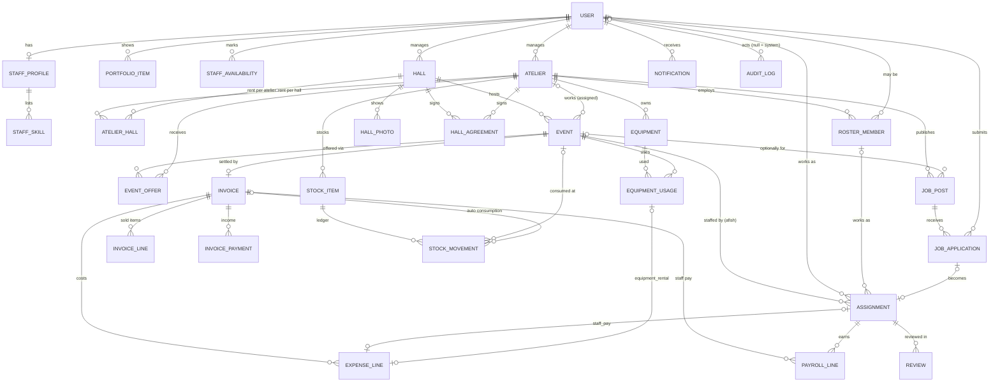

# Data model — Atelier Sayyar (اتلیه سیار)

Relational model + the small domain services that sit directly on it.
Source of truth for the business rules is `/AGENTS.md`; this document describes
how those rules are stored and which code is allowed to change them.

* Code: `app/extensions.py`, `app/models/*.py`, `app/services/{constants,staffing,notifications,audit,eventbus}.py`
* Tests: `tests/test_models.py`, `tests/test_staffing_service.py`, `tests/test_eventbus.py`
* Stack: SQLAlchemy 2.x typed models (`Mapped` / `mapped_column`) on Flask-SQLAlchemy 3, SQLite in development, PostgreSQL-portable (the whole schema is compiled against the PostgreSQL dialect in the tests).

```python
from app.extensions import db            # db, login_manager, csrf
from app.models import User, Event, Assignment, Invoice   # importing registers every table
from app.services import staffing, notifications, audit, eventbus
from app.services.constants import Role, Skill, EventStatus, LABELS_FA, PRODUCT_CATALOG
```

## 1. Conventions

| Topic | Rule |
|---|---|
| **Money** | Integer Toman, never float. Columns are `BIGINT` with `CHECK (col >= 0)` (only `invoices.net_profit` may be negative). Model validators accept Persian/Arabic/Latin digits and thousands separators (`"۱٬۵۰۰٬۰۰۰"` → `1500000`) and reject floats, bools and negatives with an exception *at assignment time*. |
| **Time** | Timestamps are **naive UTC** in Python and in the DB — use `app.models.utcnow()`. An aware datetime written to the DB is converted to UTC (not truncated). `date` columns are Gregorian; Jalali is a presentation concern (`jdate`, `jdatetime` filters). |
| **Enums** | Stored as `VARCHAR` + a named `CHECK (col IN (...))` (portable, no native enums). The Python side is a `str`-based `StrEnum` from `constants.py`; an attribute always holds the *member* (`event.status = "done"` becomes `EventStatus.DONE`), compares equal to its string, and an unknown value raises `ValueError` immediately. `member.label` is the Persian label. |
| **PKs / FKs** | Integer surrogate PKs. **Every foreign key is indexed** (a test enforces it). FK `ON DELETE` policy: owned child rows `CASCADE`; business history `RESTRICT`; optional references and "who did it" `SET NULL`. SQLite foreign keys are switched on (`PRAGMA foreign_keys=ON`) for every engine by `app.models.base`. |
| **Constraint names** | Deterministic via a naming convention on the metadata (`pk_`, `uq_`, `ix_`, `ck_`, `fk_` + table + columns), all ≤ 63 chars (PostgreSQL limit) so migrations never depend on auto-generated names. |
| **JSON** | `sa.JSON(none_as_null=True)` (portable; plain `TEXT` on SQLite, `JSON` on PostgreSQL). JSON is never queried in SQL, only read/written whole. **Assign a new value, do not mutate in place** (`a.bonus_tiers = [...]`), JSON columns are not change-tracked. |
| **Defaults** | Python-side column defaults are applied at construction (`Event().status is EventStatus.DRAFT` before any flush). |
| **Units of work** | Services call `add` + `flush`, **never `commit`/`rollback`**; the request handler owns the transaction. |
| **Mobile numbers** | Always stored as `09xxxxxxxxx` (`normalize_mobile` accepts Persian/Arabic digits, `+98`, `0098`, spaces, dashes); an invalid number raises `ValueError`. Applies to `users`, `otp_codes`, `roster_members`. |
| **Timestamps columns** | `created_at` / `updated_at` on mutable entities; append-only rows (`otp_codes`, `notifications`, `audit_logs`, `stock_movements`) have only `created_at`; pure child rows (`staff_skills`, `invoice_lines`, `invoice_payments`, `expense_lines`) have none. |

## 2. ER overview



Reading guide — the spine of the business is
`Hall → Event → Assignment → (Invoice → PayrollLine)`:
a hall manager creates **Events**, an **Atelier** gets them (offer/accept or
direct), the atelier manager staffs each event with **Assignments** (platform
users or its own roster, each with a terms snapshot), and after the ceremony
one **Invoice** records sales, income, expenses and the computed **PayrollLines**.

Standalone (no business FKs): `otp_codes` (keyed by mobile), `settings`, `announcements`.

## 3. Tables

Only the non-obvious is listed. `PK` columns, `created_at`/`updated_at` omitted.

### Identity and staff

| Table | Purpose / notes |
|---|---|
| `users` | `mobile` **unique**; `password_hash` nullable (OTP login is primary, A6); `role` ∈ `Role`; `status` ∈ `pending\|active\|suspended` (default `pending`); `is_verified`; `is_public_profile`. Flask-Login ready: `is_active` is false only for *suspended* users (pending users can sign in), `is_approved` means `status == active`. A `user_loader` is registered in `app.models.user` (returns `None` for suspended users). Does not inherit `UserMixin` on purpose: its `__eq__` makes all unsaved users equal. |
| `otp_codes` | `code_hash` is an HMAC of mobile+code (`OtpCode.hash_code`), never the code. `attempts`, `expires_at`, `consumed_at`, `ip`. `OtpCode.verify()` implements expiry / attempt-limit / constant-time compare / consume. Indexes `(mobile, created_at)` and `(ip, created_at)` serve rate limiting. |
| `staff_profiles` | One per user (`user_id` unique). `expected_base`, `expected_commission_per_unit` are only a *hint* shown to ateliers; they never feed payroll. `owns_camera/flash/lens/phone_light/printer/laptop`, `is_listed`, `rating_avg` (the only float in the schema) + `rating_count` (`refresh_rating()` recomputes from non-hidden reviews). `profile.skills` is a list property over `staff_skills`; `StaffProfile.with_skill("editor")` is a ready-made `WHERE` expression. |
| `staff_skills` | `(profile_id, skill)` unique. A child table (not JSON) so "photographers in Shiraz" is an indexed portable query. |
| `portfolio_items` | `user_id`, `image_path`, `caption`, `sort_order`, `is_public`. |
| `staff_availability` | `(user_id, date)` **unique**; `status` ∈ `unavailable\|available`, `note`. No row = unknown. |

### Organisations

| Table | Purpose / notes |
|---|---|
| `halls` | `manager_id` (RESTRICT), `(manager_id, name)` unique, `city`, `address`, `phone`, `notes`, `is_active`. Added by the `halls` module: `map_url`, `logistics` JSON (loading, power, wifi, parking, setup_spot, contact_name, contact_phone - free text, ≤ 300 chars each), `default_ceremony_types` JSON list of `CeremonyType` values, `default_rent` (Toman, nullable: what the hall usually charges an atelier per event), `single_atelier_per_day` (the hall gives one atelier only per date, see §6 `event_offers`). |
| `hall_photos` | `hall_id` (CASCADE), `image_path` **unique** (relative `uploads` path, kind `hall`, at most 12 per hall), `caption`, `sort_order`. Visible to signed-in users through `/media`. |
| `hall_agreements` | A hall's agreement with an atelier (توافق‌نامه): `hall_id`, `atelier_id` (CASCADE), `start_date`, `end_date` (NULL = open-ended), `is_exclusive`, `rent_per_event` **or** `revenue_share_percent` (0-100), `deposit`, `contact_name/phone`, `notes`, `terminated_at` (ended early; history is kept), `reminded_at` (idempotence of the expiry reminder). Active on day *d* = not terminated, `start_date <= d`, `end_date` empty or `>= d` (`HallAgreement.is_active_on`, `HallAgreement.active_on(d)` for SQL). |
| `ateliers` | The employer. `default_venue_rent` (Toman), `default_pay_presets` JSON `{role: terms}` (suggestions that pre-fill the afish form, never applied silently), `print_yield` JSON (nullable override of `DEFAULT_PRINT_YIELD`, A4), `block_double_booking` BOOLEAN (default false: the afish board *warns* about a busy / unavailable person and accepts an explicit override; true: the board refuses). The flag is read by the `ateliers` UI only, `staffing.assign_person` keeps its `allow_conflict` switch. Existing databases need `ALTER TABLE ateliers ADD COLUMN block_double_booking BOOLEAN NOT NULL DEFAULT 0` (no migrations yet). `rent_for_hall(hall)` implements the fallback below. |
| `atelier_halls` | `(atelier_id, hall_id)` unique, `rent_amount` nullable. **Rent rule:** `rent_for_hall(hall, on=None)` = this row's `rent_amount` if set, else `rent_per_event` of an agreement of the atelier with that hall that is active on *on* (default today), else `halls.default_rent`, else `ateliers.default_venue_rent`. The invoice pre-fills the venue-rent expense with it and the user may override. |
| `roster_members` | The atelier's fixed staff (A7: may have no account). `user_id` nullable link, `display_name`, `mobile`, `skills` JSON list, `default_terms` JSON `{role: terms}`, `is_active`. `(atelier_id, user_id)` unique. `terms_for(role)` = own default → atelier preset → `None`. |

### Events and staffing

| Table | Purpose / notes |
|---|---|
| `events` | `hall_id` (RESTRICT), `atelier_id` (SET NULL; NULL until accepted/assigned), `date`, `start_time`, `ceremony_type`, `guest_count_estimate`, `offer_mode` ∈ `open\|direct\|none` (default `none`), `status` (default `draft`), `staffing_needs` JSON `{role: head_count}` (default one of each role). **(hall, date) is deliberately not unique**: lunch + dinner events exist; `start_time` tells them apart. |
| `event_offers` | `(event_id, atelier_id)` unique (re-offering reuses the row); **partial unique index** allows at most one `accepted` offer per event. `offered_at` = when the offer last became pending (creation or re-offer), `responded_at` = when the atelier answered; their difference is the *response time* of the hall reports. `offered_by_id` is the hall manager for a direct offer and the claiming atelier manager for an event taken from the public board (that is how the reports tell a *claim* from an answered offer). |
| `assignments` | **The afish.** See §5. |
| `job_posts` | An atelier's public call: `role`, `date`, `city`, `title`, `slots ≥ 1`, `status`, plus the *offered* terms (same three snapshot columns as assignments). `event_id` optional. |
| `job_applications` | `(post_id, user_id)` unique; `status`; `decided_at`. `assignments.job_application_id` links the resulting assignment (`source = marketplace`). |
| `reviews` | 1–5 stars (validator + `CHECK`), `author_id <> subject_id` (`CHECK`), `is_hidden` for moderation. Two kinds of target (`CHECK has_target`): a **staff review** hangs on an `assignment_id` (`(assignment_id, author_id)` unique); an **event review** has no assignment but `event_id` + `atelier_id`: the hall manager rates the atelier that worked the event (`subject` = the atelier's manager; `(event_id, author_id)` unique). `assignment_id` is therefore nullable - code that walks `review.assignment` must handle `None`. Atelier ratings (hall directory) = average of the non-hidden reviews with that `atelier_id`. |

### Accounting (formulas from AGENTS.md, A2 / A5)

```
units      = Σ qty × commission_weight      over invoice_lines with counts_for_commission
income     = card_reader + card_to_card + cash          (invoice_payments)
expenses   = venue_rent + staff_pay + equipment_rental + material + other   (expense_lines)
net_profit = income − expenses                           (may be negative)
```

| Table | Purpose / notes |
|---|---|
| `invoices` | **One per event** (`event_id` unique, RESTRICT). `status` ∈ `draft\|submitted\|settled\|void`. Totals **snapshot**: `income_total`, `expense_total`, `net_profit`, `units_total`, written by `Invoice.refresh_totals()` from the child rows; `revision`, `submitted_by_id`, `submitted_at`. |
| `invoice_lines` | `category` ∈ print/raw_file/edited_file/frame/chassis; `size_label` canonical `'16x21'` (`''` for file products — a `CHECK` makes sized categories require a size and file categories forbid one); `is_custom_size` ("+ other size" rows); `qty ≥ 0`; `commission_weight` **integer** ≥ 0 (default 1, "تعداد محاسبه برای حقوق نیرو"); `counts_for_commission` (A2). Rows may repeat. Aliases `weight` / `counts` let a line be passed straight to `payroll.units_from_lines`. |
| `invoice_payments` | `(invoice_id, method)` unique → at most three rows (card reader / card-to-card / cash), `amount ≥ 0`. |
| `expense_lines` | `kind`, `label`, `amount`, `is_auto`. `assignment_id` only allowed on `staff_pay`, `equipment_usage_id` only on `equipment_rental` (`CHECK`s), each at most once per invoice (unique). |
| `payroll_lines` | `(invoice_id, assignment_id)` unique. `units, base, commission, bonus, total` with **`CHECK total = base + commission + bonus`**; `applied_tier` JSON `{threshold, amount}` or NULL; `role` and `person_name` copied for a stable sheet; `paid_at`, `paid_method` ∈ `PayoutMethod`, `paid_note` (`paid_method` requires `paid_at`). `snapshot_person(assignment)` fills the copies. The arithmetic is `app.services.payroll`, not the model. |

`Invoice.refresh_totals()` and `compute_*()` read the `lines` / `payments` / `expenses`
relationship collections, so add rows **through the relationship**
(`invoice.lines.append(...)`) or `db.session.refresh(invoice)` first; a row inserted with
only `invoice_id` is invisible to an already-loaded collection.

### Inventory and equipment

| Table | Purpose / notes |
|---|---|
| `stock_items` | `kind` paper/ink/frame/chassis/cellophane/other, `brand`, `size_label`, `paper_size` A4/A3, `sheets_per_pack` (20 or 50 by brand), `unit`, `quantity` (**may go negative** so a late entry never blocks an invoice; `is_low` flags it), `unit_cost`, `low_stock_threshold`. Optimistic locking through `version` (`StaleDataError` when two requests race). Change quantity **only** via `item.record_movement(delta, reason, ...)`. |
| `stock_movements` | Append-only ledger: signed non-zero `delta`, `reason`, optional `event`/`invoice`, `is_auto`, `unit_cost`, `actor`. Item deletion is RESTRICTed. |
| `equipment` | `kind`, `ownership` owned/rented, `rent_cost_per_event`, `serial`, `condition`, `is_active`. `event_cost` = rent for rented gear, 0 for owned. |
| `equipment_usages` | `(event_id, equipment_id)` unique; `rent_cost_snapshot` frozen at attach time (`EquipmentUsage.snapshot` / `staffing.attach_equipment`). |

### Platform

| Table | Purpose / notes |
|---|---|
| `notifications` | `user_id`, free `kind` (well-known ones in `NotificationKind`), `title`, `body`, `url`, optional `entity_type`/`entity_id`, `read_at`. Indexes `(user_id, read_at)`, `(user_id, created_at)`. |
| `audit_logs` | **Append-only** (ORM `before_update`/`before_delete` raise `AuditLogImmutableError`; a bulk SQL `DELETE` — e.g. a retention job — deliberately bypasses the guard). `actor_id` NULL = system (also after the user is deleted), `action` (dotted verb), `entity_type` = **table name**, `entity_id`, `data` JSON, `ip`. |
| `settings` | `key` unique, JSON `value`. `Setting.get(key, default)` falls back to `constants.SETTING_DEFAULTS`; `Setting.set(key, value, actor=)` upserts. |
| `announcements` | Role-targeted (`audience`), scheduled (`starts_at`/`ends_at`) banners; `Announcement.active_for(role)` returns the `select`. |

## 4. Enums, labels and state machines

All enums live in `app/services/constants.py` with Persian labels in
`LABELS_FA[group][value]` (group = snake_case class name, e.g. `"user_status"`);
`Enum.choices()` gives `(value, label)` pairs for `<select>`;
`label_fa(group, value)` is the safe lookup for raw strings. A test asserts that
every member of every enum has a Persian label.

`PRODUCT_CATALOG` (invoice popup) — categories in the AGENTS.md order with
`label`, `standard_sizes` (`16x21`, `20x30`, `30x40`), `allows_custom_sizes`,
`custom_label` ("چاپ/قاب/شاسی ابعاد دیگر"), `requires_size`, `stock_kind`,
`default_counts_for_commission`. `standard_invoice_rows()` yields the 11 fixed
rows of the popup; `normalize_size_label("۱۶ × ۲۱") == "16x21"`.

**Event** (`EVENT_TRANSITIONS`) — the normal path is
`draft → open → offered → confirmed → done → invoiced`:

| From | May go to |
|---|---|
| `draft` | `open`, `offered`, `confirmed`, `cancelled` |
| `open` | `draft`, `offered`, `confirmed`, `cancelled` |
| `offered` | `open` (offer declined/withdrawn), `confirmed`, `cancelled` |
| `confirmed` | `open` (the atelier hands it back: atelier cleared, staff cancelled), `done`, `cancelled` |
| `done` | `invoiced`, `confirmed` (re-open) |
| `invoiced` | `done` (invoice voided / re-opened) |
| `cancelled` | `draft` (reactivate) |

**Assignment** (`ASSIGNMENT_TRANSITIONS`):

```
invited ──► accepted ──► confirmed ──► completed (terminal)
   │  │         │            │
   │  └─► confirmed (manager skips the wait)     any non-terminal ─► cancelled (terminal)
   └─► declined ──► invited (re-invite)           accepted ─► declined (backs out)
```

Status groups used by the services: `ACTIVE_ASSIGNMENT_STATUSES` (invited,
accepted, confirmed, completed — the person is busy that day),
`COMMITTED_…` / `FILLED_…` (accepted, confirmed, completed — someone said yes,
fills a slot), `CLOSED_EVENT_STATUSES` (done, invoiced, cancelled — no more staffing).
Offer, application and invoice tables exist too (`OFFER_/APPLICATION_/INVOICE_TRANSITIONS`);
`is_legal_transition(table, old, new)` checks any of them.

## 5. The afish and the terms snapshot

`assignments` = **event + role + exactly one person + a frozen copy of the pay terms**.

* Exactly one person: `CHECK` that either `user_id` or `roster_member_id` is set, never both/neither. Both FKs are RESTRICT (history).
* Terms columns: `base_pay`, `commission_per_unit`, `bonus_tiers` JSON `[{"threshold": 70, "amount": 150000}]`, the same trio as `job_posts` (shared `TermsMixin`). Tiers are validated, sorted by threshold, duplicate thresholds rejected. Per A1 the *highest reached* tier applies and tiers do not stack (payroll's job; the model only stores).
* **Terms dict** — the interchange shape used everywhere, identical to `payroll.terms_to_dict`: `{"base", "commission_per_unit", "bonus_tiers"}`. `assignment.terms_dict()` → dict, `assignment.pay_terms()` → `payroll.PayTerms` (payroll imported lazily), `payroll.terms_from_dict(a.terms_dict())` round-trips.
* **Snapshot immutability**, three layers:
  1. *By design*: terms are copied in when the assignment is made. Changing `StaffProfile.expected_*`, a roster `default_terms` or an atelier `default_pay_presets` later never touches existing assignments (tested).
  2. *Service*: `staffing.set_terms` is the one sanctioned editor (audited, published, notifies the person; refused for cancelled assignments).
  3. *Lock*: `terms_locked_at`. `staffing.lock_event_terms(event)` (call it when an invoice is **submitted**) freezes every committed assignment. A `before_update` ORM guard then raises `TermsLockedError` for **any** code path that changes the terms or the identity (`event_id`, `role`, `user_id`, `roster_member_id`); it reads the stored row, so a stale in-memory copy cannot bypass a lock set by another request. A locked assignment also cannot be declined/cancelled. `staffing.unlock_terms` (reopening an invoice) lifts it. Setting identical values is not a change.
* Uniqueness: partial unique indexes allow the same person **one active assignment per role per event** (a declined/cancelled row does not block a new one). The same person may hold two different roles on one event (each with its own terms); that is not reported as a double booking.
* "Same person": an assignment through a roster member is the same human as the user the roster entry links to, and roster entries / accounts that share a mobile number are treated as one person (`staffing.resolve_identity`). `Assignment.involving_user(user_id)` is the SQL condition for "my afish" (direct + via roster).

## 6. Services

All in `app/services`, all use only `db.session`, none commits.

### `staffing`

| Function | Behaviour |
|---|---|
| `assign_person(event, role, *, user=None, roster_member=None, terms, actor, source=None, call_time=None, notes=None, status=None, job_application=None, allow_conflict=False, check_permissions=True)` | Creates the assignment with a terms snapshot (dict or `PayTerms`; **required**). Initial status `invited` for users, `confirmed` for roster members (no acceptance needed, A7). `source` auto-derived (`roster`/`marketplace`/`direct`). Raises `DuplicateAssignment` (never overridable), `AssignmentConflict` (override with `allow_conflict`), `EventNotStaffable` (no atelier, or event done/invoiced/cancelled), `StaffingPermissionError`, `StaffingError` (foreign/inactive roster, suspended user). Audits `assignment.created`, publishes `assignment.changed`, notifies the person. |
| `set_terms(assignment, terms, actor, reason=None)` | See §5. No-op for identical terms. |
| `lock_terms` / `lock_event_terms(event)` / `unlock_terms` | See §5. |
| `transition(assignment, new_status, actor, reason=None, allow_conflict=False)` | Table-driven (`InvalidTransition`). Same status = idempotent no-op. Becoming committed re-checks the person's other *committed* assignments that day. Sets `responded_at` on accept/decline. Notifies the manager when the assignee answers and the assignee when a manager acts. |
| `change_event_status(event, new_status, actor, reason=None)` | Event table. `cancelled` cancels active assignments; `done` completes accepted/confirmed ones and drops unanswered invitations; `confirmed→open` clears the atelier; `confirmed` requires an atelier; a locked assignment vetoes cancellation. Publishes `event.status_changed`, notifies the hall and atelier managers. |
| `conflicts_for(date, user_id=None, roster_member_id=None, exclude_assignment_id=None, *, exclude_event_id=None, statuses=None)` | Active assignments of the same person on that date (non-cancelled events), ordered by start time. Includes other ateliers — UI must not leak their details. |
| `check_assignable(event, role, user=/roster_member=)` | Dry run for UI warnings: `.conflicts`, `.duplicates`, `.unavailable` (a `StaffAvailability` row), `.ok`. |
| `staffing_summary(event)` | `roles` in workflow order (presenter → photographer → seller → editor); per role `needed`, `filled` (accepted+confirmed+completed), `invited` (waiting), `missing` (nobody asked: `needed − filled − invited`), `shortfall` (`needed − filled`), `surplus`; totals, `is_fully_staffed`, `to_dict()`. |
| `attach_equipment` / `detach_equipment` | Snapshot rent onto `equipment_usages`; idempotent; detach refused after the invoice is submitted. Publishes `equipment.assigned`. |

**Who may do what** (`actor` is a User, an id, a Flask-Login proxy, or `None` = system; an anonymous or suspended actor is refused, never treated as the system; `check_permissions=False` skips authorisation but still audits the real actor):

| Action | admin | atelier manager of the event | assignee | hall manager of the event's hall | others |
|---|---|---|---|---|---|
| assign / set_terms / lock / unlock / equipment | yes | yes | no | no | no |
| assignment transition | any legal | any legal | accept, decline, withdraw (cancel) | no | no |
| event status | yes | yes | no | yes | no |

### `event_offers`

Owned by the `halls` module, used by `halls` (hall side) and meant for `ateliers` (atelier side). Handing a date to an atelier, and taking it, live **only** here.

| Function | Behaviour |
|---|---|
| `offer_events(events, ateliers, actor, message=None)` | Direct offers for every (event, atelier) pair. New pairs create a row, declined / withdrawn ones are **renewed** (same row, `offered_at` restarts), a pending pair is skipped. Events become `offered` / `direct`. Events that cannot be offered (taken, cancelled, past) or that an exclusive agreement reserves for another atelier are *skipped with a reason* (`OfferBatch.skipped`), not an error. One notification per atelier manager per batch. |
| `open_to_all(events, actor)` / `close_open(event, actor)` | Publish on every atelier's board (`offer_mode=open`, `status=open`) / stop. Pending direct offers are withdrawn first. Ateliers of the hall's city (active, active manager, at most 200) get one notification per call. |
| `withdraw_offer(offer, actor)` / `reoffer(offer, actor)` / `withdraw_pending(event, actor)` | Hall side. When no pending offer is left on an `offered` event it becomes `open` again (`offered -> open`, `offer_mode=none`). |
| `accept_offer(offer, actor)` -> Event, `decline_offer(offer, actor)` -> EventOffer, `claim_open_event(event, atelier, actor)` -> Event | Atelier side (signatures are stable). Taking an event is a **conditional UPDATE** (`WHERE atelier_id IS NULL AND status IN (open, offered)`) inside a SAVEPOINT: exactly one winner, the loser gets `OfferUnavailable` and leaves no row behind; the partial unique index on `accepted` offers is the second line of defence. The other pending offers of the event are withdrawn (their managers are told). The event is confirmed through `staffing.change_event_status` (so the hall manager gets the usual status notification with the reason «X مراسم را پذیرفت/برداشت»). Declining the last pending offer reopens the event. |
| `release_accepted(event)` | An atelier that handed an event back or was cancelled no longer "holds" it: its `accepted` offer becomes `withdrawn` (audit `offer.released`). Called by the `halls` event-bus handler on `event.status_changed` (`confirmed -> open/draft/cancelled`) and by `accept/claim` for leftovers. |
| `check_exclusivity(event, atelier)` / `exclusive_agreement_for(event)` | Raises `ExclusivityConflict` when an **active exclusive agreement** of the hall covers the date and belongs to another atelier, or the hall has `single_atelier_per_day` and another atelier already holds a non-cancelled event of that hall that day. Checked when offering, accepting and claiming (an accept re-checks, so an agreement signed after the offer still wins). |

Errors: `OfferError` (Persian message, safe to flash) with `OfferUnavailable`, `OfferNotAllowed` (the actor does not manage the hall / atelier concerned), `ExclusivityConflict` (`.holder`). Audit actions: `offer.created|reoffered|withdrawn|accepted|declined|claimed|released`, `event.opened|open_closed` (the hall's event page renders them as a timeline). Nothing is committed here; on an `OfferError` the caller rolls back.

### `eventbus`

Synchronous in-process pub/sub. `subscribe(name, fn)` (idempotent; also `@subscribe(name)`), `unsubscribe`, `publish(name, **payload)` → `PublishResult(delivered, failed)`, `isolated()` (test helper: empty registry, restored afterwards — **do not call `clear()` in tests**, it would unplug other modules' import-time handlers). Subscriber exceptions are logged and swallowed; the publisher never sees them. Handlers receive the payload as keyword arguments and may declare only the ones they need. Handlers run inside the publisher's transaction: they must not commit/rollback; wrap risky DB work in `begin_nested()`.

| Event | Payload | Published by |
|---|---|---|
| `invoice.saved` | `invoice_id, event_id, atelier_id, actor_id, created` | the invoice module after it saved/re-saved an invoice (**not** published by this layer) |
| `assignment.changed` | `assignment_id, event_id, change` (`created\|status\|terms\|locked\|unlocked`)`, old_status, new_status, actor_id, user_id` | `staffing` |
| `event.status_changed` | `event_id, old_status, new_status, actor_id` | `staffing.change_event_status` |
| `equipment.assigned` | `event_id, equipment_id, usage_id, actor_id, removed` | `staffing.attach_equipment` / `detach_equipment` |

### `notifications`, `audit`

* `notify(user_or_id, kind, title, body='', url=None, *, entity=None)` — `None` user (a roster member without account) is a silent no-op, so callers need no special case. If `url` is omitted the resolver registered with `set_url_resolver(fn(kind, entity_type, entity_id))` may build it (the app shell knows the routes). Also `notify_many`, `unread_count`, `recent`, `mark_read(user, ids=None)` (only touches the user's own rows), `mark_all_read`.
* `audit.log(actor, action, entity, data=None, *, ip=None)` — entity = model instance, `(table, id)` or `None`; `data` is made JSON-safe and secrets under keys such as `password`, `code`, `token` are replaced by `***`; `ip` defaults to the current request's address. `audit.actor_id(actor)` is the shared "who is this?" helper.
* Actions written by `staffing`: `assignment.created|invited|accepted|declined|confirmed|completed|cancelled|terms_changed|terms_locked|terms_unlocked`, `event.<status>`, `equipment.attached|detached`.

## 7. PostgreSQL portability

No SQLite-only SQL anywhere: portable column types (`VARCHAR`, `BIGINT`, `JSON`, `TIMESTAMP WITHOUT TIME ZONE`, `BOOLEAN`), enum `CHECK`s instead of native enums, no JSON queries, partial unique indexes declared with both `sqlite_where` and `postgresql_where`, optimistic locking via a version column instead of `SELECT … FOR UPDATE`. `tests/test_models.py` compiles the entire schema with the PostgreSQL dialect and checks identifier lengths, that every FK is indexed, that every money column is `BIGINT` + `CHECK >= 0`, and that the only float is `rating_avg`.

Run the same suites on PostgreSQL by pointing `ATELIER_TEST_DB_URL` at a throwaway
database (needs a driver such as `psycopg2-binary`):

```bash
ATELIER_TEST_DB_URL=postgresql+psycopg2://user@/atelier_test pytest tests/test_models.py tests/test_staffing_service.py
```

The suites were run green on SQLite 3.45 and PostgreSQL 16, with SQLAlchemy 2.0.54 and 2.1.4.

Race conditions the application must tolerate: two concurrent `assign_person` calls can both pass the duplicate check; the partial unique index then makes the second flush raise `IntegrityError` (map it to "already assigned"). Two concurrent stock updates raise `StaleDataError` (retry).

## 8. Assumptions and open questions

Decisions made where AGENTS.md is silent — please confirm or change:

1. **`commission_weight` is an integer ≥ 0.** AGENTS.md says the box is "increasable/decreasable" with default 1; fractional weights would make `units × commission_per_unit` non-integer Toman. (`payroll.SaleLine.weight` is an int too.) Weight 0 is allowed ("sold but pays no commission").
2. **Users start as `pending`.** Who flips to `active` (admin approval, or automatically after OTP for staff) belongs to the auth module. `is_active` (Flask-Login) is false only when suspended.
3. **Pay terms can change after the person accepted** (`set_terms` only notifies). A stricter "re-acceptance required" rule would be a one-line extension in `set_terms`.
4. **A person can be double-booked only deliberately.** "Same date" is the literal rule (A hall hosting lunch and dinner events counts as a clash); `allow_conflict=True` is the override. Invited-but-unanswered assignments count as busy for new invitations, only accepted/confirmed/completed ones block *accepting*.
5. **Roster members are `confirmed` immediately** (no accept step); roster members with an account are still notified.
6. **Venue rent fallback** applies when there is no `atelier_halls` row *or* its `rent_amount` is NULL.
7. **Deleting people.** Managers, assignees and anything with accounting history are `RESTRICT`ed; use `status = suspended` instead of deleting users. A GDPR-style "anonymise" operation would be an explicit, separate feature.
8. **One role per user.** A hall manager who is also a photographer needs a second account.
9. **`InvoiceStatus.settled`** (all payroll lines paid) and the `void` status are our addition to the invoice life cycle; the spec only said "status".
10. License (A8) is untouched by this layer.
11. **Venue rent sources (halls module).** AGENTS.md says the invoice's venue rent defaults to the amount in the atelier's settings. The hall panel adds two *more specific* sources between the atelier's per-hall price and its generic default: the signed agreement's `rent_per_event` and the hall's `default_rent` (order in `Atelier.rent_for_hall`). The atelier's own per-hall price still wins and the invoice line stays editable. Confirm, or drop the two extra tiers.
12. **Hall ratings** are stored as `Review` rows without an assignment (`event_id` + `atelier_id`), not in a new table, so the admin's moderation (`is_hidden`) and any future "reviews of me" view see them. The cost: `reviews.assignment_id` is nullable.
13. **Schema additions of the halls module** (no Alembic yet; existing databases need them by hand): `halls` gets `map_url VARCHAR(500)`, `logistics JSON NOT NULL DEFAULT '{}'`, `default_ceremony_types JSON NOT NULL DEFAULT '[]'`, `default_rent BIGINT CHECK (default_rent >= 0)`, `single_atelier_per_day BOOLEAN NOT NULL DEFAULT 0`; `event_offers` gets `offered_at TIMESTAMP`; new tables `hall_photos` and `hall_agreements` (`db.create_all()` creates them); `reviews` gets `event_id` / `atelier_id` (FKs, indexed) and `assignment_id` becomes nullable - SQLite cannot drop NOT NULL, so recreate the table (or use Alembic batch mode), PostgreSQL: `ALTER TABLE reviews ALTER COLUMN assignment_id DROP NOT NULL`, plus the `has_target` check and the two unique constraints from `app/models/marketplace.py`.
14. **Duplicate events.** `(hall, date)` stays non-unique; the *exact* slot (hall, date, start time, `NULL` counts as a value) of a live - not cancelled - event is refused by the halls module (application check, serialised per hall with `SELECT ... FOR UPDATE` on PostgreSQL), not by a database constraint: a unique index over a nullable time would not cover untimed events and would break lunch/dinner pairs of other modules' tests.

## 9. Adding to the model — checklist

1. Subclass `BaseModel` (+ `TimestampMixin` unless append-only); import the module in `app/models/__init__.py` and add the class to `ALL_MODELS`.
2. Use `fk(...)` for foreign keys (indexed), `money()` for Toman, `choice(Enum, "col")` for enums, `json_col()` for JSON, `UTCDateTime` for timestamps, and add `money_checks(...)`.
3. Add a `@validates` for money/integers (`check_money`, `check_int`).
4. Enum values and Persian labels go in `constants.py` (`LABELS_FA`), then `pytest tests/test_models.py` — the schema-level tests fail if a FK is unindexed, money lacks a `CHECK`, a label is missing, or an identifier exceeds 63 characters.
